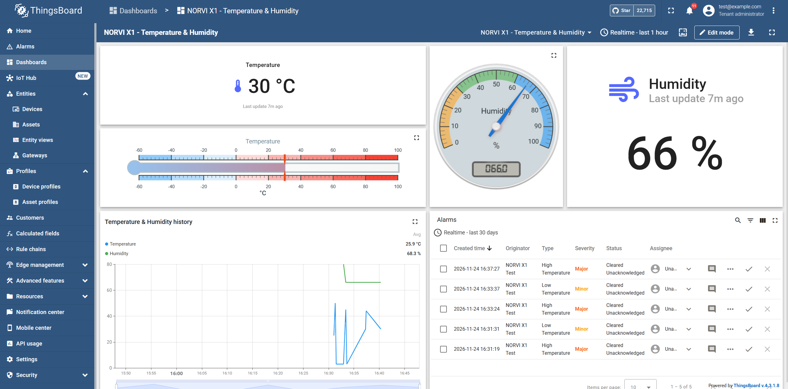

# NORVI X1 + ThingsBoard: Temperature & Humidity (RS-485, Wi-Fi)

Ready-to-import ThingsBoard device profile, alarm rules and dashboard for the
[NORVI X1 (CPU-ESPS3-X1)](https://shop.norvi.lk/products/norvi-x-cpu-modules) reading an
**XY-MD02** Modbus RTU temperature/humidity sensor over its built-in RS-485 port and sending the
data to ThingsBoard over Wi-Fi (MQTT).

**Tested on:** ThingsBoard CE **v4.3.1.8** (self-hosted, Docker), clean install, 24 Nov 2026.
The alarm rules use the Alarm Rules 2.0 format, so ThingsBoard **4.3 or newer** is required.

## What's in this folder

| File | Purpose |
|---|---|
| `device-profile.json` | Device profile "NORVI X1 - Temperature & Humidity (RS485)" |
| `alarm-rules/high-temperature.json` | Alarm rule: High Temperature (Major) |
| `alarm-rules/low-temperature.json` | Alarm rule: Low Temperature (Minor) |
| `dashboard.json` | Dashboard (6 widgets): history chart, Temperature card, Humidity card, Alarms table, Humidity gauge, Temperature scale |
| `firmware/norvi_x1_xy_md02_thingsboard/` | Arduino sketch (placeholders only: add your own Wi-Fi and token) |

## Telemetry keys

| Key | Unit | Description |
|---|---|---|
| `temperature` | °C | Air temperature from the XY-MD02 |
| `humidity` | %RH | Relative humidity from the XY-MD02 |

## Alarms

| Alarm | Severity | Created when | Cleared when |
|---|---|---|---|
| High Temperature | Major | `temperature` > 35 | `temperature` < 33 |
| Low Temperature | Minor | `temperature` < 5 | `temperature` > 7 |

## Import steps (in this order)

1. **Device profile.** Profiles > Device profiles > **+** > **Import device profile** > `device-profile.json`.
2. **Alarm rules.** Open the imported profile > **Alarm rules** tab > **+ (Add alarm rule)** > import `alarm-rules/high-temperature.json`, then `low-temperature.json`.
3. **Device.** Entities > Devices > **+** > Add new device, with the profile "NORVI X1 - Temperature & Humidity (RS485)". Open it > **Manage credentials** and copy the access token (keep it private).
4. **Dashboard.** Dashboards > **+** > **Import dashboard** > `dashboard.json`. It finds devices by profile name, so no device has to be chosen by hand.

If a widget stays empty, check that the device's profile name matches exactly and that the
telemetry keys are `temperature` and `humidity`.

## MQTT topic and payload

| Item | Value |
|---|---|
| Host | `mqtt.thingsboard.cloud` or your own ThingsBoard host (port 1883) |
| MQTT username | the device access token |
| MQTT password | empty |
| Topic | `v1/devices/me/telemetry` |
| Payload | `{"temperature":31.05,"humidity":61.79}` |

You can test without hardware by adding telemetry on the device's **Latest telemetry** tab,
or by sending the same payload from any MQTT client.

## Hardware

- NORVI X1 (ESP32-S3), built-in RS-485 port (TX IO15, RX IO16, automatic direction control).
- XY-MD02 sensor: A to A, B to B, common GND, powered from its own supply.
- Sensor settings used: slave address 1, 9600 baud 8N1, input registers `0x0001` (temperature)
  and `0x0002` (humidity), raw value / 100. Other units may use a different scale, so check your manual.

## Firmware

Sketch: [`firmware/norvi_x1_xy_md02_thingsboard/norvi_x1_xy_md02_thingsboard.ino`](firmware/norvi_x1_xy_md02_thingsboard/norvi_x1_xy_md02_thingsboard.ino)

- Arduino IDE board: **ESP32S3 Dev Module**, Upload Speed 115200, USB Mode **Hardware CDC and JTAG**, USB CDC On Boot **Enabled**, Flash 16 MB, Partition **Huge APP**, PSRAM enabled.
- Libraries: ModbusMaster, PubSubClient.
- Edit `WIFI_SSID`, `WIFI_PASSWORD` and `TB_TOKEN` in your own copy. Never commit them.
- Open the Serial Monitor at 115200. You should see `Publishing: {...}` every 10 seconds.

> TODO: add real Serial Monitor output from the X1.

## Licence

TODO: confirm licence with the reviewer (e.g. MIT).

## Links

- [NORVI X CPU modules](https://shop.norvi.lk/products/norvi-x-cpu-modules) (confirm this is the preferred X1 link)
- [ThingsBoard](https://thingsboard.io)
