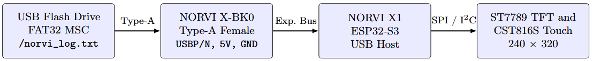
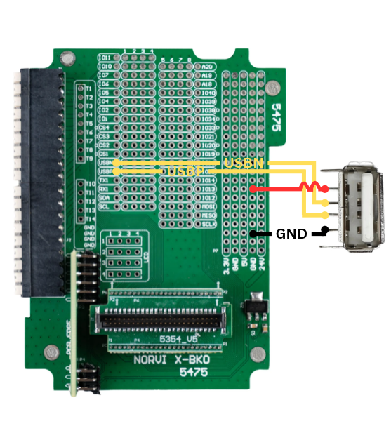
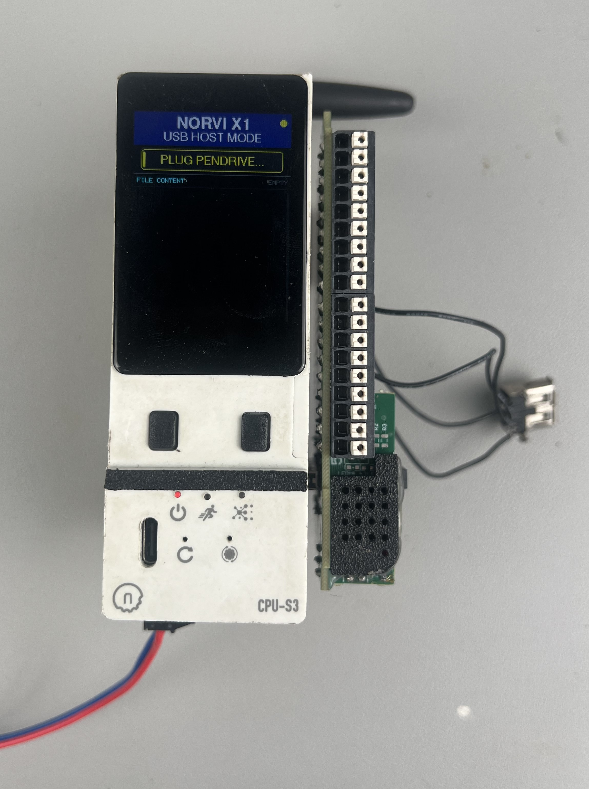
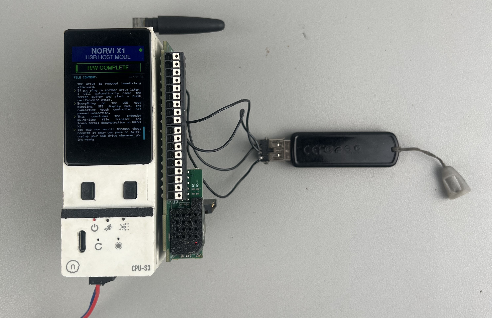

# **NORVI X: USB Host Mode, With X-BK0** 

### **1. Introduction** 

Industrial edge controllers often need to exchange logs, calibration tables, and backups with removable media without a host computer. The ESP32-S3 in the NORVI X1 has a native FullSpeed USB peripheral that can act as a USB Host for Mass Storage Class (MSC) flash drives formatted as FAT32. 

The NORVI X-BK0 expansion module breaks out the X1’s USB differential pair (USBP/USBN) and regulated 5V/GND rails to screw terminals. Wiring a Type-A female USB receptacle to these terminals gives the X1 a rugged, dedicated USB Host port without an OTG adapter. 

This tutorial covers the X-BK0 wiring, Arduino IDE configuration, firmware architecture, and a commissioning procedure that reads /norvi_log.txt, writes an identical copy (/norvi_log_cpy.txt), and displays the text on the onboard ST7789 TFT with touch scrolling. 

### **2. System Architecture** 

The system bridges the ESP32-S3 native USB host controller through the X-BK0 expansion bus to an external Type-A female USB receptacle, while driving the SPI TFT display and I2 C capacitive touchscreen on the NORVI X1 front panel. 

<!-- Start of picture text -->
USB Flash Drive  Type-A NORVI X-BK0 Exp.  NORVI X1  SPI / I 2 C ST7789 TFT and FAT32 MSC Type-A Female ESP32-S3 CST816S Touch /norvi_log.txt USBP/N, 5V, GND USB Host 240  ×  320 <!-- End of picture text -->

Figure 1: Signal and power path from the USB flash drive through the X-BK0 expander to the NORVI_X1

##### **2.1 Operational Sequence** 

1. **Peripheral Isolation and Bus Init.** On boot, the sketch parks unused chip-select lines on the shared SPI bus (W5500_CS and SD_CS), initializes I2 C for the CST816S touch controller, and starts the ST7789 display. 

2. **USB Host Enumeration.** USBHost.begin() activates the ESP32-S3 USB peripheral in Host Mode across the X-BK0 expansion interface. While waiting for media, the header status dot blinks yellow and the status card displays PLUG PENDRIVE.... 

3. **Filesystem Mount.** When a flash drive is plugged into the Type-A female socket wired to X- BK0, USBHostMSC.mounted() becomes true, the status dot switches to green, and USBMSCFS.begin() mounts the FAT32 partition at /usb. 

4. **Buffered Read, Write, and Display.** The controller opens /norvi_log.txt for reading and creates /norvi_log_cpy.txt for writing. Data is transferred in 128-byte blocks, word-wrapped with uniform indentation, and streamed live to the display. 

5. **Safe Unmount and Touch Inspection.** After closing both files, USBMSCFS.end() unmounts 

NORVI X1 & X-BK0 USB Host 

the volume cleanly so the drive can be removed without file-allocation-table corruption. The operator can drag vertically across the text pane to review long files. 

##### **2.2 Hardware Components** 

Table 1: Hardware components required for NORVI X and X-BK0 USB host-mode operation

|**Component**|**Role**|**Key details**|
|---|---|---|
|NORVI X1 (CPU-S3)|Host controller|ESP32-S3 dual-core MCU, native USB PHY (GPIO 19/20), 2.0 in ST7789 TFT (240_×_320), CST816S capacitive touch,24 V DC supply|
|NORVI X-BK0|Expansion breakout|Side-mounted expansion module breaking outUSBP,USBN, 5V,andGNDterminals from the X1 expansion connector|
|USB Type-A Female Connector|Host receptacle|4-pin USB Type-A female socket (breakout board or panel-mount pigtail) wired to the X- BK0 terminals l|
|USB Flash Drive|Mass storage|USB 2.0/3.0 flash drive formatted as**FAT32**containing /norvi_log.txtin the root directory|
|24 V DC Power Supply|Main power|Powers the NORVI X1 and regulates the internal5V rail delivered to the X-BK0 and flash drive|

##### **2.3 Pin Allocation and Shared Bus Management** 

**Table 2: **GPIO and expansion interface allocation on the NORVI X

|**Function**|**GPIO /** **Terminal**|**Notes**|
|---|---|---|
|USB Host Data (D _−_/ D+)|IO19 / IO20|Routed via the X1 expansion port toUSBNandUSBP on X-BK0|
|SPI Bus (MOSI / MISO / SCLK)|IO11 / IO13 / IO12|Shared across TFT, W5500 Ethernet, and SD card reader|
|TFT Display (CS / DC / RST)|IO45 / IO46 / _−_1|ST7789 panel driven at 10 MHz SPI; software reset(_−_1)avoids conflict withTOUCH_INT|
|SPI Chip-Select Parks|IO1 / IO42|W5500_CS(IO1) andSD_CS(IO42) drivenHIGHat boot toprevent SPI bus contention|
|Capacitive Touch (I2C)|IO8 / IO9|SDA = 8,SCL = 9,INT = 47,RST = 48(CST816Sat address0x15)|

## **3. Hardware Assembly and X-BK0 Wiring** 

#### **3.1 Wire the Type-A Female USB Connector to X-BK0** 

Wire the four pins of the USB Type-A female receptacle to the corresponding terminals on the X- BK0 expander according to Table 3. 

Table 3: Wiring between the NORVI X-BK0 expander terminals and a USB Type-A female connector

|**X-BK0** **Terminal**|**USB Type-A** **Pin**|**Standard Wire** **Color**|**Function** l|
|---|---|---|---|
|5V|Pin 1 (VBUS)|Red|+5 V DC power output to the flash drive|
|USBN|Pin 2 (D_−_)|White|USB differential data negative (GPIO 19)|
|USBP|Pin 3 (D+)|Green|USB differential data positive (GPIO 20)|
|GND|Pin 4 (GND)|Black|Power and signal ground reference|

###### **Verify Polarity and Shared USB Lines** 

- **Check** 5V **and** GND **before inserting media:** Reversing 5V and GND on the Type-A female connector will immediately damage an inserted USB flash drive. Verify 5.0 V across Pin 1 and Pin 4 with a multimeter before plugging in a drive. 

- **Keep data leads short and twisted:** Keep the USBP and USBN wires short (under 15 cm) and twisted together to maintain USB signal integrity. 

- **Programming vs. Host Mode:** Because the X-BK0 USBP/USBN terminals share GPIO 19/20 with the NORVI X1 programming port, disconnect the flash drive from the X-BK0 receptacle whenever uploading firmware from a PC 

#### **3.2 Mount the X-BK0 Expander** 

1. Switch off the 24 V DC supply before attaching or wiring expansion hardware. 

2. Mount the NORVI X-BK0 module on the DIN rail immediately beside the NORVI X1 and press it firmly onto the side expansion bus connector until latched. 

3. Connect the 24 V DC industrial supply to the +24V and GND power terminals on the NORVI X1. 

Figure 2: Complete wiring from NORVI X-BK0 terminals ( 5V , USBN , USBP , GND ) to the Type-A female connector

### **4. Arduino IDE Configuration and Libraries** 

##### **4.1 Board Settings** 

Select ESP32S3 Dev Module as the board and configure the following under **Tools** before compiling and uploading (Table 4). 

Table 4: Arduino IDE board settings for the NORVI X1 USB Host sketch

|**Setting**|**Value**|
|---|---|
|Board|ESP32S3 Dev Module|
|USB CDC On Boot|Disabled|
|CPU Frequency|240MHz(WiFi)|
|Core DebugLevel|None|
|USB DFU On Boot|Disabled|
|Erase All Flash Before Sketch Upload|Disabled|
|Events Run On|Core 1|
|Flash Mode|QIO 80MHz|
|Flash Size|16MB(128Mb)|
|JTAG Adapter|Disabled|
|Arduino Runs On|Core 1|
|USB Firmware MSC On Boot|Disabled|
|Partition Scheme|Default 4MB withspiffs(1.2MB APP/1.5MB SPIFFS)|
|PSRAM|QSPI PSRAM|
|Upload Mode|USB-OTG CDC (TinyUSB)|
|Upload Speed|921600|
|USB Mode|Hardware CDC and JTAG|

**USB CDC On Boot** must stay Disabled so the CDC serial device does not claim the USB peripheral before USBHost.begin() runs. 

##### **4.2 Required Libraries** 

Install the following libraries via the Arduino Library Manager or vendor repository: 

Table 5: Arduino libraries used in the USB Host sketch

|**Library**|**Header(s)**|**Purpose**|
|---|---|---|
|ESP32 USB Host MSC|USBHost.h, USBHostMSC.h, USBMSCFS.h|Enumerates USB Mass Storage devices on USBP/USBN and mounts FAT32partitions [1]|
|Adafruit GFX & ST7789|Adafruit_GFX.h, Adafruit_ST7789.h|Renders header banners, status cards, justified text rows,and scrollbars[2]|
|CST816S Touch Driver|CST816S.h|Reads capacitive touch coordinates over I2C for bidirectional scrolling [3]|

### **5. Firmware Architecture and Key Routines** 

##### **5.1 Shared SPI Bus and Pin Conflict Prevention** 

On the NORVI X1, the ST7789 TFT controller shares SPI lines (SCLK=12, MISO=13, MOSI=11) with the W5500 Ethernet chip (CS=1) and microSD slot (CS=42). In addition, GPIO 47 is wired to the capacitive touch interrupt (TOUCH_INT). Driving W5500_CS and SD_CS high before calling SPI.begin() isolates the TFT, while passing -1 as TFT_RST prevents display resets from disturbing the CST816S interrupt line. 

##### **5.2 FAT32 Read and Byte-for-Byte Write (** runUsbReadWrite() **)** 

Once USBHostMSC.mounted() returns true, runUsbReadWrite() executes the file transfer pipeline: 

1. **Mount Volume:** USBMSCFS.begin("/usb", 10, false) mounts the first FAT32 partition on the flash drive. 

2. **Open Source and Destination:** USBMSCFS.open("/norvi_log.txt", FILE_READ) opens the source file, and USBMSCFS.open("/norvi_log_cpy.txt", FILE_WRITE) creates or overwrites the target copy. 

3. **Chunked Transfer and Pacing:** Data is read in 128-byte chunks (rf.read(data, 128)) and immediately written (wf.write(data, n)). A proportional delay scaled by rf.size() paces screen updates so the operator can observe live streaming. 

4. **Safe Unmount:** Both file handles are closed with .close() and USBMSCFS.end() flushes cached FAT sectors before reporting R/W COMPLETE. 

##### **5.3 Word-Wrapped Justification and Touch Scrolling** 

To display arbitrary text files cleanly on a 240 _×_ 320 portrait screen: 

- **Word Wrapping (** printFileLine **):** Paragraphs are split at word boundaries up to 35 characters (210 px), stripping leading spaces so every row aligns flush at _x_ = 18 while paragraph starts receive a yellow > marker at _x_ = 6. 

- **Full Justification (** drawJustifiedLine **):** Non-final wrapped rows distribute extra horizontal pixels evenly across inter-word spaces so both left and right text edges align cleanly. 

- **Bidirectional Touch Scroll (** touchScrollTask **):** Up to 250 wrapped rows are retained in logBuf. Because the display uses setRotation(2), vertical touch coordinates are inverted (ty = 319 - touch.data.y). Dragging downward scrolls down toward later lines, dragging upward scrolls up toward earlier lines, 

and a right-edge scrollbar indicates position. 

##### **5.4 Three-State Header Blink Indicator** 

The circular heartbeat indicator at top-right ((228 _,_ 14)) communicates hardware status at a glance: 

Table 6: Status indicator states on the NORVI X1 display header

|**Indicator Color**|**System Condition**|**Trigger Logic**|
|---|---|---|
|**Yellow**(blinking)|Ready / Idle|I2C touch healthy and USB Host initialized, waitingfor flash drive|
|**Green**(blinking)|Media Connected|USB flash drive enumerated on X-BK0 and mounted(st.mounted == true) |
|**Red**(blinking)|Hardware / Bus Fault|CST816S I2C check failed (0x15NACK) or USBHost.begin()failed|

### **6. Commissioning and Test Procedure** 

#### **6.1 Prepare the Sample File (** norvi_log.txt **)** 

Format a USB flash drive as **FAT32** (allocation unit size: Default) on a PC and save the following multi-line text as norvi_log.txt in the root directory: 

##### **6.2 Step-by-Step Verification** 

1. Ensure no flash drive is inserted into the X-BK0 USB connector, then flash the arduino code onto the NORVI X1 using the board settings in Section 4. 

2. Disconnect the PC programming cable and power the NORVI X1 from the **24 V DC** supply. 

3. Verify that the TFT shows PLUG PENDRIVE... in the status card and a blinking **yellow** dot in the upper-right header (see Figure 3). 

4. Insert the prepared FAT32 flash drive into the Type-A female connector wired to the X-BK0 expander. Observe the status sequence: PENDRIVE FOUND _→_ OPENING FILE... _→_ READING & COPYING... _→_ R/W COMPLETE, while the indicator turns **green** (see Figure 4). 

5. Slide a finger down and up across the FILE CONTENT: area to verify smooth bidirectional scrolling and scrollbar tracking. 

6. Unplug the flash drive (the display clears and returns to PLUG PENDRIVE... with a yellow dot), insert it into a PC, and confirm that norvi_log_cpy.txt matches norvi_log.txt byte-for-byte. 

Figure 3: NORVI X1 display before inserting the USB flash drive: status card reads PLUG PENDRIVE.. with a blinking yellow header indicator

Figure 4: NORVI X1 display after completing the USB read/write cycle and displaying file contents

### **7. Troubleshooting** 

Table 7: Troubleshooting guide for NORVI X1 and X-BK0 USB Host Mass Storage

|**Symptom**|**Likely cause**|**Remedy**|
|---|---|---|
|Stays onPLUG PENDRIVE...when drive is inserted|USBPandUSBNswapped, loose X-BK0 connection, or missing5 V|VerifyUSBN_→ _Pin 2 (D_−_),USBP_→ _Pin 3 (D+), check 5 V on Pin 1, and re-seat X-BK0 onto X1|
|FAT32 MOUNT FAIL|Flash drive formatted as exFAT or NTFS|Reformat the flash drive as**FAT32**(use a_≤_ 32 GBpartition if Windows hides FAT32)|
|SOURCE FILE FAIL|Missing or misnamed input file|Verifynorvi_log.txtis in the root folder (/) with exact lowercase naming|
|Header beater dot blinks**red**|CST816S I2C NACK or USB Host init error|CheckSDA=8,SCL=9, ensureTFT_RSTis_−_1, andpower-cycle the 24 V supply|
|Display remains black|Shared SPI bus contention|ConfirmW5500_CS(IO1) andSD_CS(IO42) are drivenHIGHbeforeSPI.begin()|
|Cannot upload sketch from Arduino IDE|Flash drive still attached to X-BK0 or USB in Host Mode|Unplug the drive from X-BK0; hold BOOT while pressing RESET on the X1 to enter download mode|

### **References** 

- [1] Espressif Systems, _ESP32-S3 Technical Reference Manual: USB On-The-Go (USB)_ , v1.4, 2025. 

- [2] Adafruit Industries, “Adafruit-GFX-Library & Adafruit-ST7735-Library,” GitHub repository. [Online]. Available: https://github.com/adafruit/Adafruit-ST7735-Library (accessed Nov. 23, 2026). 

- [3] F. Biego, “CST816S: Arduino library for the CST816S touch controller,” GitHub repository. [Online]. Available: https://github.com/fbiego/CST816S (accessed Nov. 23, 2026). 

- [4] NORVI, “NORVI X1 Industrial ESP32-S3 Controller Datasheet,” ICONIC DEVICES. [Online]. Available: https://norvi.lk (accessed Nov. 23, 2026). 

