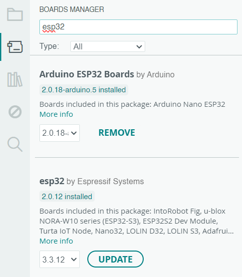
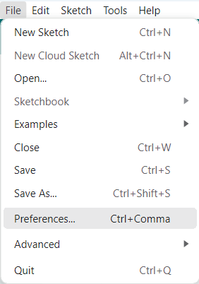
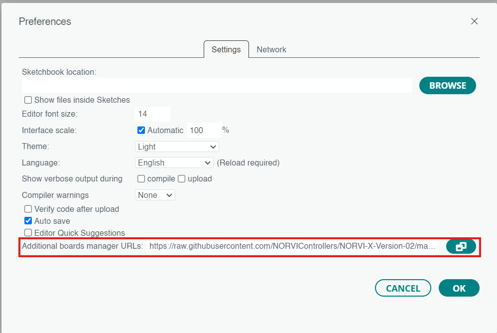
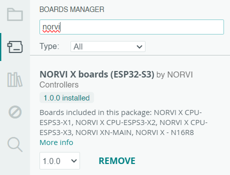
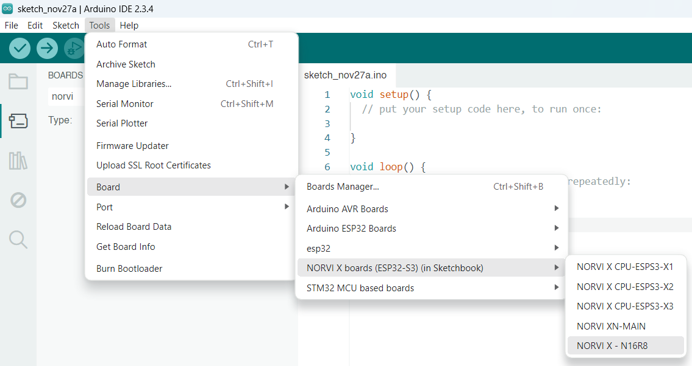

# NORVI Boards for the Arduino IDE

Use your NORVI X controller in the Arduino IDE like any other board. Install the ESP32 package, add one NORVI web link, install the NORVI package from Boards Manager, pick your model in the **Tools → Board** menu, and start programming. There is no need to set the chip, flash size, PSRAM or partition scheme by hand. The package sets them for you.

## What is this?

This is the NORVI board package for the Arduino IDE. It guides the IDE about the NORVI ESP32-S3 controllers:

| Board in the menu | Controller |
|---|---|
| NORVI X CPU-ESPS3-X1 | NORVI X1 |
| NORVI X CPU-ESPS3-X2 | NORVI X2 (cellular modem) |
| NORVI X CPU-ESPS3-X3 | NORVI X3 (cellular modem) |
| NORVI XN-MAIN | NORVI XN |
| NORVI X - N16R8 | NORVI X with the N16R8 module (OPI PSRAM) |

## What does it do for you?

Without this package, you have to choose "ESP32S3 Dev Module" and then set the board options yourself every time. With it, you choose your NORVI model and the right settings are already selected:

- 16 MB flash.
- PSRAM preset for your module: QSPI for the X1, X2, X3 and XN boards, OPI for the N16R8 board.
- USB CDC On Boot and the partition scheme preset for your model (see the table below).
- Pin definitions for the NORVI hardware, such as the I2C, SPI, Ethernet, SD card, display, touch and RS-485 pins.
- A ready-to-run example, **Blink_LEDs**, to check that your board works.

| Board | USB CDC On Boot | Partition scheme | PSRAM options |
|---|---|---|---|
| X1, X2, X3 | Enabled | Huge APP (3MB No OTA / 1MB SPIFFS) | QSPI PSRAM (default) or Disabled |
| NORVI X - N16R8 | Enabled | Huge APP (3MB No OTA / 1MB SPIFFS) | OPI PSRAM (default) or Disabled |
| XN-MAIN | Disabled | Minimal SPIFFS (1.9MB APP with OTA / 128KB SPIFFS) | QSPI PSRAM (default) or Disabled |

You can still change the other options in the Tools menu.

## What do you need?

- **Arduino IDE 2.x.** Download it from [arduino.cc](https://www.arduino.cc/en/software). Check **Help → About**: the Arduino CLI version must be **1.0.4 or newer**.
- **Arduino IDE 1.8.x (for example 1.8.19) is not supported.** This package needs the newer engine inside IDE 2.x.
- **"esp32 by Espressif Systems"**, installed from Boards Manager (Step 1 below). The NORVI package uses it for the compiler and libraries, so install it first.
- A USB data cable (not a charge-only cable) and the power supply for your NORVI controller.

## Step 1: Install "esp32 by Espressif Systems" first (required)

The ESP32 package is already listed in the Arduino IDE, so you only need to install it.

1. Open **Tools → Board → Boards Manager**.
2. Search for **esp32** and install **"esp32 by Espressif Systems"**. Be sure to pick this exact name, not "Arduino ESP32 Boards".

   

   *Choose the package named **esp32 by Espressif Systems**. The "Arduino ESP32 Boards" package above it is a different package and does not work for NORVI.*

> If you already use ESP32 boards, you probably have it already. Skip to Step 2.

## Step 2: Add the NORVI boards

1. Open **File → Preferences**.

   


2. Find **Additional boards manager URLs** (highlighted below) and click the small window icon at its right.

   


3. Add this link, then click **OK** in both windows:

   ```
   https://raw.githubusercontent.com/NORVIControllers/NORVI-X-Version-02/main/cpu/Boards/arduino/package/package_norvi_index.json   ```

4. Open **Tools → Board → Boards Manager**, search for **NORVI** and install **"NORVI X boards (ESP32-S3)"**.

   


> If you have other links in the box, put each link on its own line. If two links are on one line separated by a space, the IDE reports a "404 Not Found" error. If you use the single-line field, separate the links with a comma and no spaces.

## Step 3: Choose your board

Go to **Tools → Board → NORVI X boards** and select your model: **NORVI X CPU-ESPS3-X1**, **X2**, **X3**, **NORVI XN-MAIN**, or **NORVI X - N16R8**.

      

## Step 4: Test

Open **File → Examples → NORVI Examples → Blink_LEDs**, connect the board by USB and click **Upload**. The two on-board LEDs (ERROR and RUN) should alternate every half second. The example also prints the push-button presses on the Serial Monitor at 115200 baud.

The example finds the LEDs and buttons automatically. It looks for the PCA9536 I/O expander at address 0x41 first, and if that is not present it uses the PCA9539 at address 0x75.

If the upload does not start, hold the **BOOT** button, press **RESET**, release **BOOT**, then upload again.

## Troubleshooting

| What you see | What to do |
|---|---|
| Error: `platform esp32:esp32 is not installed` | Go back to Step 1 and install "esp32 by Espressif Systems". |
| "esp32 by Espressif Systems" is not found in Boards Manager | Update the Arduino IDE to the latest 2.x version and restart it. |
| "404 Not Found" when updating the board indexes | Put each link on its own line in Preferences. |
| No NORVI boards in the Board menu | Check that the NORVI link is added, restart the IDE, and make sure "NORVI X boards (ESP32-S3)" is installed in Boards Manager. |
| Compile errors about missing paths such as `partitions.csv` or `tools/sdk` | You are probably using Arduino IDE 1.8.x. Install Arduino IDE 2.x. |
| `'LED_BUILTIN' was not declared` | The NORVI LEDs are on an I/O expander, not a normal pin. Use **NORVI Examples → Blink_LEDs** instead of the stock Blink example. |
| Upload fails: "Failed to connect" | Use the BOOT and RESET sequence in Step 4, and try another USB cable. |
| Nothing shows in the Serial Monitor | Set the speed to 115200. On X1, X2, X3 and N16R8, keep USB CDC On Boot = Enabled. On XN-MAIN, it is Disabled by default. |

## Tested with

- Arduino IDE 2.3.4 (Arduino CLI 1.1.1)
- esp32 by Espressif Systems: 2.0.12, 3.3.12 and 4.0.0

New Espressif versions may change their board settings. If something stops working after an Espressif update, please contact us.

## More information

- Documentation: [norvi.io/docs](https://norvi.io/docs)
- Board repository: [NORVIControllers/NORVI-X-Version-02](https://github.com/NORVIControllers/NORVI-X-Version-02)
